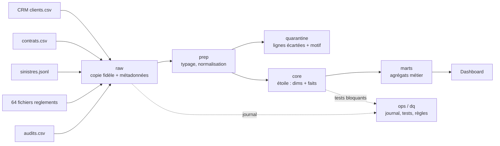

# Livrable 1 – Architecture cible

## Choix d'outils et critères mesurables
| Brique | Choix | Critère mesuré sur ce projet | Alternative écartée |
|---|---|---|---|
| Stockage / SQL | DuckDB | 41 848 lignes sources (2,6 Mo décompressés, 610 Ko compressés) ; entrepôt de 24,9 Mo ; chargement initial complet, 36 règles et 28 tests en 10,6 s, rejeu en 3,1 s (mesurés sur un poste) ; zéro serveur à administrer ; SQL analytique complet (fenêtres, `FILTER`) | PostgreSQL : serveur et droits à maintenir, sans gain à ce volume |
| Ingestion | Python (csv, pandas) | Gère encodage latin-1, séparateur `;`, en-tête `montant_eur`, JSONL, sans intervention manuelle | `COPY` SQL seul : ne tolère pas les en-têtes variables |
| Transformations | SQL versionné par couche | Lisible par un analyste, rejouable | dbt : utile à plusieurs équipes, surdimensionné pour 5 sources |
| Orchestration | Makefile (+ déclencheur mensuel à l'arrivée d'un fichier, livrable 5) | 1 commande, 0 dépendance | Airflow : coût d'exploitation disproportionné |
| Restitution | Streamlit sur les marts | Lit uniquement `marts.*` | – |

## Avec 100 fois plus de données (~4,2 millions de lignes, ~260 Mo de CSV, entrepôt de l'ordre de 2,5 Go en extrapolation linéaire)
- DuckDB tient encore sur une machine unique ; le premier point de rupture est le **chargement ligne à ligne** : on passerait à `COPY`/`read_csv` natif ou à des fichiers **Parquet** partitionnés par mois.
- Les règlements (déjà incrémentaux) resteraient en `insert-only` par partition mensuelle ; les dimensions passeraient en `MERGE` plutôt qu'en reconstruction complète.
- Si plusieurs équipes écrivent en parallèle : PostgreSQL ou un entrepôt cloud, dbt pour les tests et le lignage, Airflow ou Dagster pour planifier. Le modèle en couches ne change pas.
