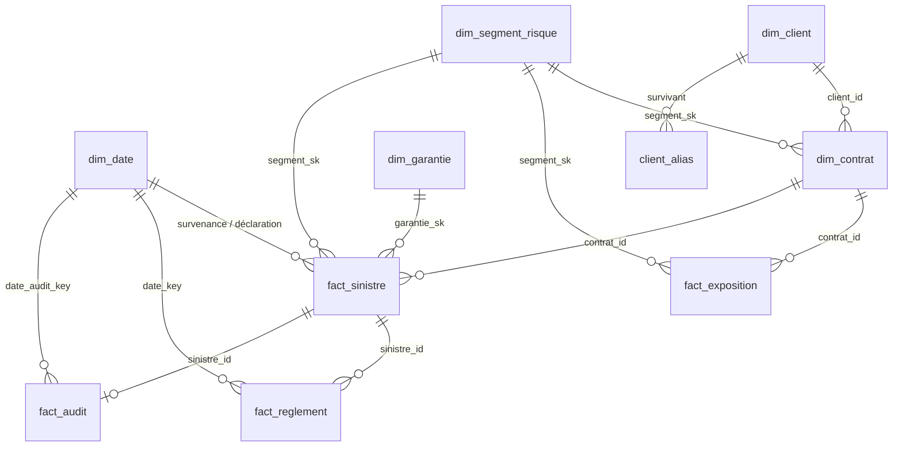

# L2 · 2.3 Modèle dimensionnel

## Schéma en étoile (couche `core`)

## Tables de faits et grains

| Table | Grain (une ligne =) | Mesures |
|---|---|---|
| fact_exposition | un contrat × une année civile | jours_couverture, exposition_annee_police, prime_acquise |
| fact_sinistre | un sinistre | reserve_initiale, nb_reglements, montant_regle, délai |
| fact_reglement | un paiement | montant |
| fact_audit | un sinistre audité | fraude_confirmee |

Pourquoi contrat × année : la fréquence se calcule par année-police (sinistres / exposition).
Un contrat souscrit en octobre ne couvre que 3 mois de son année d'effet ; sans ce grain,
on le compterait comme une année pleine et la fréquence serait sous-estimée.

## Dimensions et historisation

- dim_client : prête pour SCD2 (valid_from, valid_to, is_current). Aujourd'hui une seule version
  par client, car la source ne fournit pas l'historique des changements.
- dim_contrat : SCD1 (la valeur est écrasée). Les changements de prime ou de formule ne sont pas
  historisés par la source ; l'exposition conserve la prime utilisée l'année concernée.
- dim_segment_risque et dim_garantie : clés de substitution (segment_sk, garantie_sk).
  Le segment est figé à la souscription.
- dim_date : générée, clé entière AAAAMMJJ.
- client_alias : table de passage doublon -> survivant (déduplication par email_hash).
