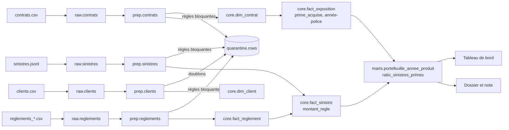

# L5 · Lignage d'un indicateur : le ratio sinistres / primes (S/P)

Ratio S/P annuel par produit = sinistres payés / primes acquises, sinistres rattachés à l'année de survenance.

## Lecture
| Étape | Ce qui se passe | Contrôle |
|---|---|---|
| Sources -> raw | copie fidèle, empreinte du fichier | T19 : journal = contenu du brut |
| raw -> prep | typage, dates normalisées, rang des doublons | |
| prep -> quarantaine / core | règles bloquantes : les lignes invalides sont écartées avec un motif | T11 à T15 : brut = cœur + quarantaine |
| core.fact_exposition | prime acquise = prime annuelle x jours couverts / jours de l'année | T10, T20 |
| core.fact_sinistre | montant payé cumulé par sinistre | T08 : tout règlement a un sinistre |
| core -> mart | on somme les sinistres payés et les primes, puis on divise | M01 à M03 : le mart retombe sur le cœur |
| mart -> tableau de bord | lecture seule, aucun recalcul | mêmes chiffres que le dossier |

## Si un chiffre est contesté
Un chiffre du tableau de bord se retrouve dans le mart, puis dans les faits du cœur, puis dans les lignes du
brut, et les lignes écartées se retrouvent dans la quarantaine avec leur motif : on peut vérifier le total de bout en bout.
