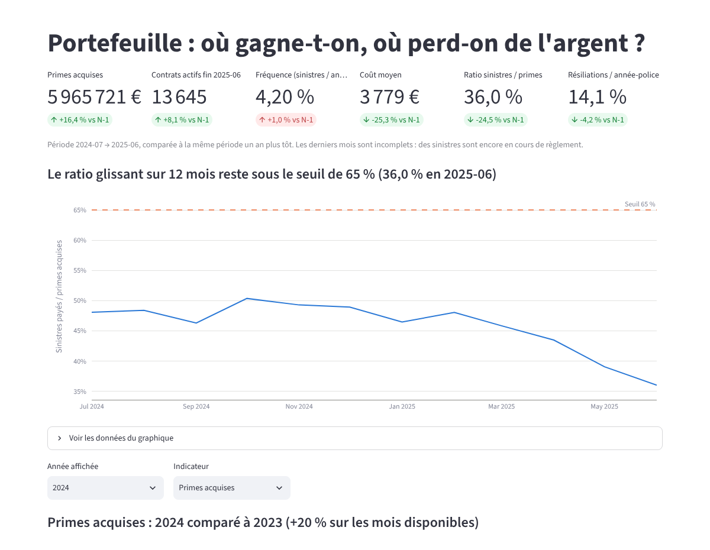
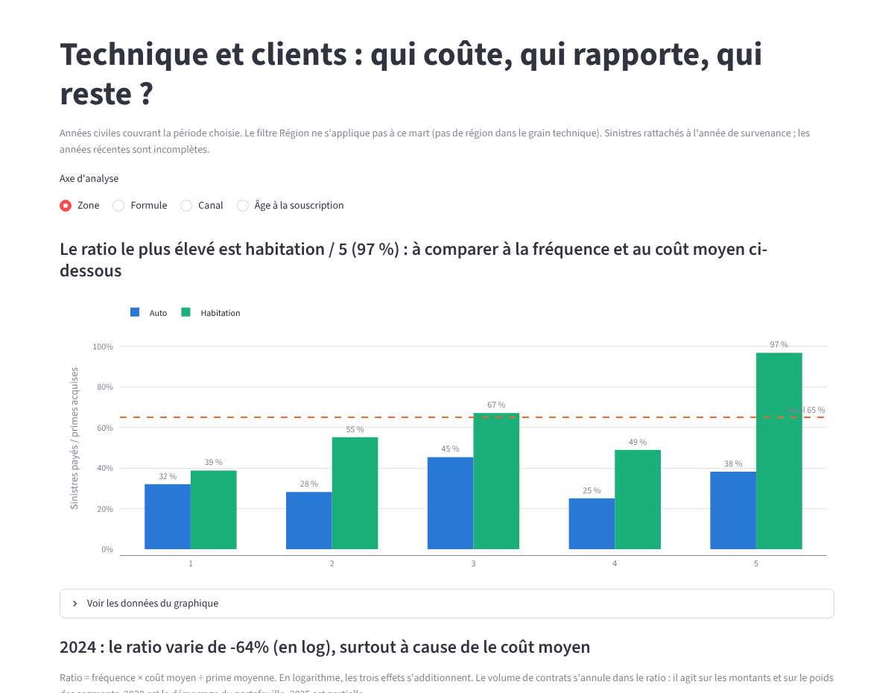
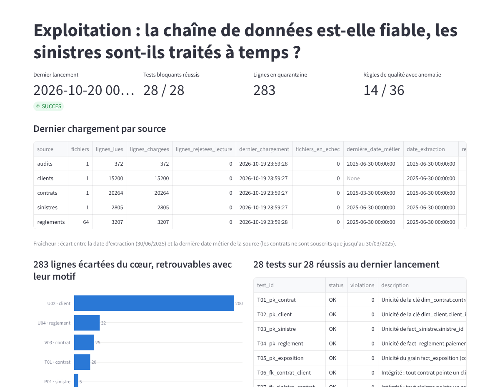

# L5 · Tableau de bord

Application Streamlit (`python -m streamlit run app/dashboard.py`). Elle **ne lit que le schéma `marts`** de l'entrepôt : aucun calcul
métier n'est refait dans l'application, donc ses chiffres sont ceux du dossier et de l'entrepôt (tests M01 à M07 : chaque mart retombe sur le cœur).

## Quatre pages
| Page | Question à laquelle elle répond |
|---|---|
| Portefeuille | Où gagne-t-on, où perd-on de l'argent ? Six indicateurs, ratio glissant sur 12 mois face à un seuil d'alerte, comparaison à l'année précédente. |
| Technique et clients | Qui coûte, qui rapporte, qui reste ? Ratio par zone, formule, canal ou âge ; décomposition fréquence, coût et prime ; contribution des segments ; rétention par cohorte ; valeur client ; délais ; audits. |
| Exploitation | La chaîne de données est-elle fiable ? Dernier lancement, 28 tests, 283 lignes en quarantaine par règle, fraîcheur de chaque source. |
| Définitions | Définition de chaque indicateur et limites de lecture. |

## Choix de conception
- **Filtres** : période, produit, région, canal, zone de risque. Quand un filtre ne s'applique pas à un mart (la région n'existe pas dans le grain technique), la page le dit.
- **Sinistre n° 1129** : un interrupteur l'exclut des calculs. Par défaut il est conservé, car c'est un sinistre réellement payé.
- **Seuil d'alerte du ratio** : 65 % par défaut. C'est une hypothèse de travail affichée comme telle et réglable, pas une valeur fournie par l'entreprise.
- **Titres qui disent le message** (par exemple « Le ratio glissant sur 12 mois reste sous le seuil de 65 % »), chaque graphique pouvant être ouvert en tableau de données.
- **Mois incomplets signalés** : les derniers mois, encore en cours de règlement, sont indiqués comme tels.

## Captures

